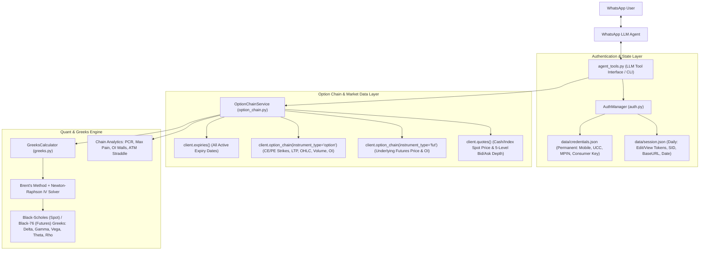

# Implementation Plan: Kotak Neo Option Chain & Greeks Engine (WhatsApp Agent Ready)

This plan outlines the architecture for fetching complete option chain data from the official [`kotak-neo-python` (v3.0.13)](https://github.com/Kotak-Neo/kotak-neo-python) SDK, computing Implied Volatility (IV) and Option Greeks ($\Delta, \Gamma, \mathcal{V}, \Theta, \Rho$), and managing permanent credentials alongside a daily TOTP workflow built specifically for a **WhatsApp LLM Agent**.

---

## 1. System Architecture Overview



---

## 2. Permanent Credentials & Daily TOTP Flow (For WhatsApp LLM Agent)

Because the code will be driven by an LLM agent living on WhatsApp, it cannot rely solely on blocking terminal `input()` calls. Instead, `AuthManager` will operate as a **non-blocking state machine** (while also supporting an interactive CLI mode for local testing):

### A. Permanent Setup (Asked Once, Saved Permanently)
Stored in `/Users/karthiksingh/Desktop/Projects/Kotak_API/data/credentials.json` (with `0600` file permissions, git-ignored):
- `consumer_key`: Trade API token from Kotak Neo App (`More → Trade API → Generate application`)
- `mobile_number`: Registered mobile number with `+91` prefix (e.g., `+919876543210`)
- `ucc`: Unique Client Code (from Kotak Neo profile)
- `mpin`: 6-digit Trading Account MPIN

**Agent Behavior:**
- If any permanent field is missing when the agent calls a tool, the tool immediately returns:
  ```json
  {
    "status": "SETUP_REQUIRED",
    "missing_fields": ["consumer_key", "mobile_number", "ucc", "mpin"],
    "agent_instruction": "Ask the user on WhatsApp for their missing permanent Kotak credentials and call save_permanent_credentials()."
  }
  ```
- Once you reply on WhatsApp, the agent calls `save_permanent_credentials(...)` and never asks for them again.

### B. Daily TOTP Lifecycle (Asked Once Every Morning)
Kotak Neo sessions expire every morning (around 6:00 AM IST). Stored in `/Users/karthiksingh/Desktop/Projects/Kotak_API/data/session.json`:
- `trading_date`: Current IST trading date (`YYYY-MM-DD`, rolling over at `06:00 AM IST`)
- `view_token`, `sid`, `edit_token`, `edit_sid`, `edit_rid`, `base_url`, `data_center`

**Agent Behavior:**
1. **Morning / First Request of the Day**:
   - You message your WhatsApp agent: *"Show me NIFTY option chain"*
   - `AuthManager` checks `data/session.json`. Seeing that today's session does not exist (or has expired), the tool returns:
     ```json
     {
       "status": "TOTP_REQUIRED",
       "agent_instruction": "Ask the user for today's 6-digit TOTP code from their Authenticator app, then call login_with_daily_totp(totp)."
     }
     ```
2. **You Reply with TOTP (`123456`)**:
   - The agent calls `login_with_daily_totp(totp="123456")`.
   - `AuthManager` loads your permanent `mobile_number`, `ucc`, `mpin`, and `consumer_key`, executes `client.totp_login(...)` followed by `client.totp_validate(...)`, and saves the resulting tokens to `data/session.json` stamped with today's IST trading date.
3. **All Subsequent Requests Today**:
   - Every call for the rest of the day automatically rehydrates `NeoAPI` from `data/session.json` in `<1ms` without asking for TOTP again.
   - If the Kotak server ever returns `401`/`403` mid-day, `AuthManager` invalidates `session.json` and triggers `TOTP_REQUIRED` cleanly.

> [!TIP]
> **Optional Proactive Morning Prompt**: We will also include a helper entrypoint (`check_morning_totp()`) that your WhatsApp cron/scheduler can run at 9:00 AM IST on trading days to proactively message you: *"Good morning! Send me your 6-digit Kotak TOTP to unlock today's session."*

---

## 3. Fetching All Aspects of the Option Chain

Using `kotakneoapi` (`v3.0.13`), our `OptionChainService` will aggregate four distinct data sources into one unified structure:

### A. Active Expiries (`client.expiries`)
- Fetches all upcoming ISO expiry dates (`YYYY-MM-DD`) for the given underlying (`NIFTY`, `BANKNIFTY`, `FINNIFTY`, `MIDCPNIFTY`, `SENSEX`, or any F&O stock like `RELIANCE`, `HDFCBANK`) across `nse_fo`, `bse_fo`, or `mcx_fo`.
- Automatically selects the **nearest active expiry** if the user/agent doesn't specify one.

### B. Per-Strike Option Chain (`client.option_chain(..., instrument_type="option")`)
Fetches `count` strikes around ATM (default `20` or `40`, configurable up to full chain) and extracts for every strike (`CE` and `PE`):
- **Contract metadata (`common_data`)**: `mktLot` (lot size), `multiplier`, `unlSymbol`, `exSeg`, `expiryDt`.
- **Instrument identifiers**: `neoSymbol` (e.g., `nse_fo|71472`), `symbol` (`NIFTY26NOV24500CE`), `strikePrice`, `optionType` (`CE`/`PE`), `moneyness` (`ITM`, `ATM`, `OTM`).
- **Price & Volume (`quote`)**: `ltp`, `open`, `high`, `low`, `prevClose`, `close`, `volume`, plus computed `netChange` and `pctChange`.
- **Open Interest (`openInterest`)**: `current`, `previous`, `change` (OI buildup/unwinding), `changePct`, plus OI expressed in **number of lots** (`current / mktLot`).

### C. Underlying Spot & Futures Price Discovery
To compute accurate Greeks & IV, we need the exact underlying reference price:
1. **Underlying Futures Chain (`client.option_chain(..., instrument_type="fut")`)**:
   - Fetches the matching-expiry (or near-month) Futures LTP (`F`), volume, and OI change.
2. **Underlying Cash / Index Spot (`client.quotes`)**:
   - Fetches real-time Cash/Index Spot LTP (`S`), day OHLC, and change for indices (`Nifty 50`, `Nifty Bank`, etc.) and F&O equities.
3. **Optional 5-Level Bid/Ask Market Depth (`client.quotes`)**:
   - Using the `neoSymbol` tokens from the option chain (`nse_fo|71472`), can fetch 5-level order book (`depth.buy` / `depth.sell`), VWAP (`avg_cost`), and circuit limits (`low_price_range` / `high_price_range`) for selected strikes (batched up to 50 tokens/call).

### D. Chain-Level Summary & Sentiment Metrics
Computed automatically on every option chain fetch so the WhatsApp LLM agent can answer high-level questions immediately:
- **ATM Strike & Implied ATM Straddle**: Combined `ATM CE LTP + ATM PE LTP`, plus implied breakeven range ($\text{ATM} \pm \text{Straddle}$).
- **PCR (Put-Call Ratio)**: Both **OI PCR** ($\frac{\sum \text{Put OI}}{\sum \text{Call OI}}$) and **Volume PCR** ($\frac{\sum \text{Put Vol}}{\sum \text{Call Vol}}$).
- **Max Pain Strike**: Strike price minimizing total intrinsic payout of all open Call and Put contracts.
- **Support & Resistance (OI Walls)**: Top 3 Call OI strikes (Resistance) and Top 3 Put OI strikes (Support), plus highest intraday OI addition/unwinding strikes.

---

## 4. Implied Volatility (IV) & Greeks Calculation Engine

Located in `kotak_option_chain/greeks.py`, built with `numpy` and `scipy`:

### A. Pricing Models Supported
- **Black-76 Model (Default for NSE F&O)**: Uses the matching-expiry Futures price $F$ as the forward price. This is the institutional standard for Indian options because $F$ naturally embeds implied dividends and cost-of-carry without needing manual dividend yield guesses.
- **Black-Scholes-Merton Model (Spot Mode)**: Uses Spot price $S$, risk-free rate $r$ (default `6.70%` based on India 91-day T-bill, configurable), and dividend yield $q$ (default `0.0%`).

### B. Exact Intraday Time-to-Expiry ($T$)
- Computes exact time remaining until **15:30:00 IST on the expiry date**:
  $$T = \frac{\max(t_{\text{expiry, 15:30 IST}} - t_{\text{now, IST}}, \text{60 seconds})}{365 \times 86400}$$
- Prevents division-by-zero on expiry day and ensures accurate intraday Theta and Gamma decay.

### C. IV Solver & Greeks Calculated per Strike
1. **Implied Volatility ($\text{IV}$)**:
   - Solved via **Brent's root-finding method (`scipy.optimize.brentq`)** bracketed on $\sigma \in [0.001, 5.0]$ ($0.1\%$ to $500\%$ annualized IV).
   - If an option's LTP is below its discounted intrinsic value (common in illiquid deep ITM strikes), IV is gracefully flagged as `intrinsic_discount` so it never crashes.
2. **Delta ($\Delta$)**:
   - Call: $e^{-qT} N(d_1) \in [0, 1]$, Put: $e^{-qT} (N(d_1) - 1) \in [-1, 0]$ (or $e^{-rT} N(d_1)$ in Black-76).
3. **Gamma ($\Gamma$)**:
   - Sensitivity of Delta per 1-point move in the underlying: $\frac{e^{-qT} \phi(d_1)}{S \sigma \sqrt{T}}$.
4. **Vega ($\mathcal{V}$)**:
   - Option price change in ₹ per **1% (+0.01)** increase in IV: $\frac{S e^{-qT} \phi(d_1) \sqrt{T}}{100}$.
5. **Theta ($\Theta$)**:
   - Option price decay in ₹ per **1 calendar day**: $\frac{\partial V / \partial t}{365}$.
6. **Rho ($\Rho$)**:
   - Option price change in ₹ per **1% (+0.01)** change in interest rate.

---

## 5. Project Structure in `/Users/karthiksingh/Desktop/Projects/Kotak_API`

```text
/Users/karthiksingh/Desktop/Projects/Kotak_API/
├── pyproject.toml / requirements.txt   # kotakneoapi, numpy, scipy, pydantic, rich
├── .gitignore                          # Ignores data/credentials.json, data/session.json, .venv
├── data/                               # Local persistent storage (0600 permissions)
│   ├── credentials.json                # Permanent: consumer_key, mobile_number, ucc, mpin
│   └── session.json                    # Daily: tokens, sid, base_url, trading_date
├── kotak_option_chain/
│   ├── __init__.py
│   ├── config.py                       # Credential & daily session file persistence
│   ├── auth.py                         # AuthManager (permanent setup + daily TOTP login)
│   ├── greeks.py                       # Black-Scholes & Black-76 IV + Greeks engine
│   ├── option_chain.py                 # OptionChainService (expiries, chain, spot/fut, depth, PCR/MaxPain)
│   ├── formatters.py                   # WhatsApp-friendly Markdown tables & compact summaries + JSON
│   └── agent_tools.py                  # LLM Function-Calling tools + schemas for WhatsApp integration
├── cli.py                              # CLI tool (interactive mode & --json mode for agent subprocesses)
└── tests/
    ├── test_greeks.py                  # Unit tests for IV solver, Delta, Gamma, Vega, Theta
    ├── test_auth_session.py            # Unit tests for permanent credentials & daily TOTP expiry
    └── test_option_chain_parser.py     # Unit tests for option chain aggregation & analytics
```

---

## 6. Verification Plan

1. **Unit Tests (`pytest`)**:
   - Verify Black-Scholes & Black-76 IV and Greeks ($\Delta, \Gamma, \mathcal{V}, \Theta, \Rho$) against known benchmark values and put-call parity.
   - Verify `AuthManager` state transitions: `SETUP_REQUIRED` $\rightarrow$ `TOTP_REQUIRED` $\rightarrow$ `AUTHENTICATED` $\rightarrow$ next-day expiration rollover.
   - Verify option chain parsing, Max Pain, PCR, and OI wall calculations using sample Kotak Neo API payloads.
2. **Live End-to-End Test**:
   - Configure your permanent credentials once and test a live TOTP login + live option chain fetch (e.g. `NIFTY`) with full Greeks table output.
